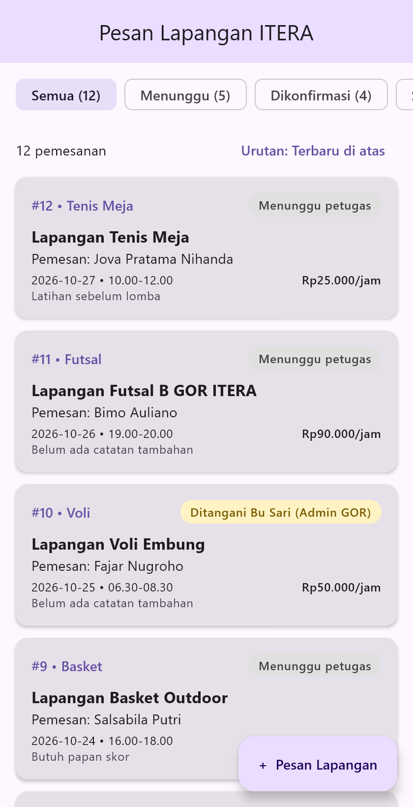

## Pembagian Tugas
| No | Nama | NIM | Mengerjakan | Berkas Terkait |
|---|---|---|---|---|
| 1 | Bimo Auliano | 124140198 | **Kartu Entitas** (`KartuPemesanan` untuk entitas utama dan `LabelStatus` berdasarkan `sealed class StatusPemesanan` dari Modul 2) | `ui/KartuPemesanan.kt`, `ui/LabelStatus.kt` |
| 2 | Jova Pratama Nihanda | 124140019 | **Daftar Data Contoh** (12 data contoh dari `data class` Modul 2 lewat sumber palsu `ambilSemua()`, serta filter & urutan dengan fungsi koleksi) | `data/DataContoh.kt`, `data/SumberPemesananPalsu.kt`, `model/DaftarPemesananExt.kt` |
| 3 | Muhammad Faza Prasetyo | 124140204 | **Layar Daftar & Aksi Utama** (`LazyColumn`, `FilterChip`, tombol urutan, FAB tambah data, unit test, dan tangkapan layar README) | `ui/LayarDaftarPemesanan.kt`, `App.kt`, `commonTest/.../DaftarPemesananTest.kt`, `README.md` |

---

## Tangkapan Layar



---

## Ringkasan Implementasi Modul 3

Modul 3 melanjutkan kode Modul 2 (model `Pemesanan`, `Lapangan`, `StatusPemesanan`, dan `SumberPemesananPalsu`). Layar pertama dibuat di `shared/src/commonMain/kotlin/id/ac/itera/pesanlapangan/ui/`.

### 1. Kartu Entitas
- **`LabelStatus.kt`**: label berbentuk *pill* yang warnanya ditentukan `when` pada `StatusPemesanan` (abu-abu = menunggu, kuning = dikonfirmasi, hijau = selesai) dan teksnya dari `label()` Modul 2.
- **`KartuPemesanan.kt`**: `Card` berisi nomor & jenis olahraga, `LabelStatus`, nama lapangan, pemesan, jadwal, harga per jam, dan `infoCatatan()` (*null safety*).

### 2. Daftar Data Contoh
- **`DataContoh.kt`**: 6 `Lapangan` dan 12 `Pemesanan` contoh dengan status yang bervariasi.
- **`SumberPemesananPalsu.ambilSemua()`**: memuat daftar contoh dengan `delay(500)`, jadi layar memakai sumber palsu kelompok sendiri, bukan data tempelan.

### 3. Filter & Urutan (Fungsi Koleksi)
- **`DaftarPemesananExt.kt`**:
  - `saringStatus(filter)` memakai `filter { }`.
  - `urutkanJadwal(terbaruDulu)` memakai `sortedWith(compareByDescending { tanggal }.thenByDescending { jamMulai })`, sehingga jadwal **terbaru tampil di atas**.
  - `hitungPerStatus()` memakai `associateWith` + `count` untuk angka di setiap chip.

### 4. Layar & Aksi Utama
- **`LayarDaftarPemesanan.kt`**: `Scaffold` + `CenterAlignedTopAppBar`, `LazyRow` berisi `FilterChip` (Semua / Menunggu / Dikonfirmasi / Selesai), tombol pengganti urutan, `LazyColumn` berisi `KartuPemesanan` (memakai `key = id`), serta **FAB "+ Pesan Lapangan"** di pojok kanan bawah (belum berfungsi).

---

## Cara Menjalankan
Dari dalam direktori `Modul 3`:
```bash
./gradlew :desktopApp:run      # menjalankan aplikasi desktop
./gradlew :shared:jvmTest      # menjalankan unit test
```
