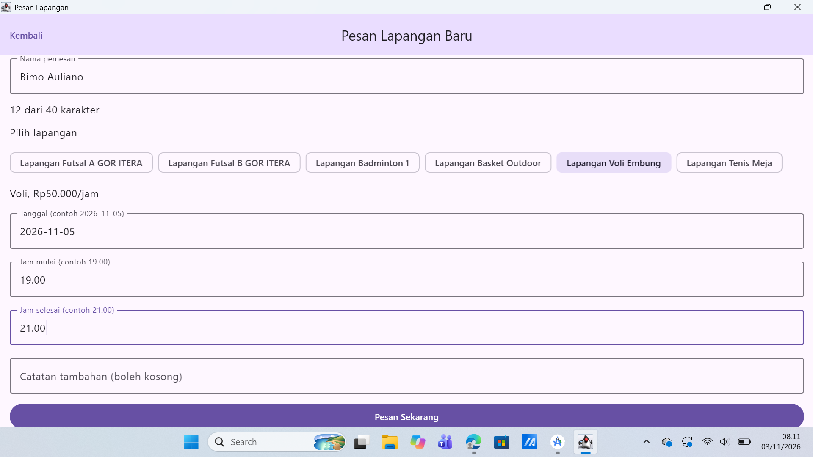
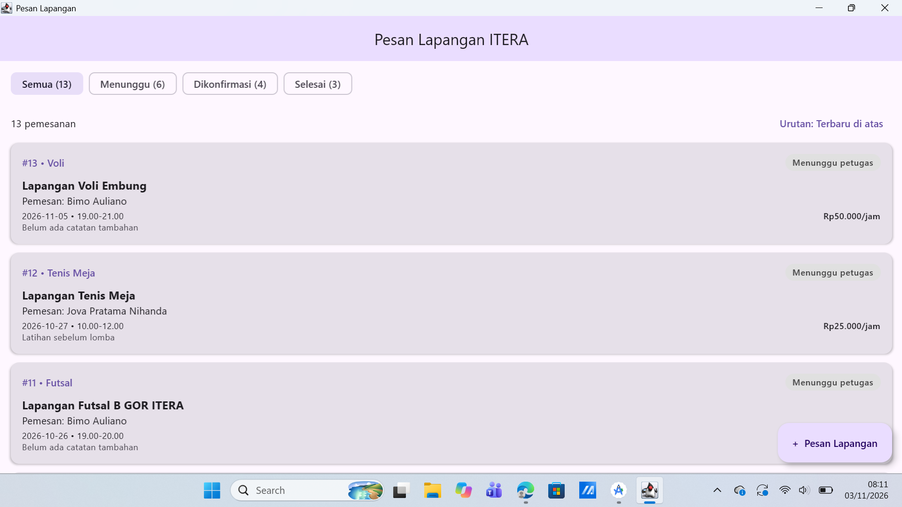

## Pembagian Tugas
| No | Nama | NIM | Mengerjakan | Berkas Terkait |
|---|---|---|---|---|
| 1 | Bimo Auliano | 124140198 | **UiState dan ViewModel** (`FormPemesananUiState` dengan `bisaSimpan` yang dihitung, `FormPemesananViewModel` dengan `StateFlow`) | `ui/FormPemesananUiState.kt`, `ui/FormPemesananViewModel.kt` |
| 2 | Jova Pratama Nihanda | 124140019 | **Layar Form** (`KolomTeks` tanpa state yang dipakai ulang, `PilihanLapangan`, `FormPemesananScreen`) | `ui/KolomTeks.kt`, `ui/PilihanLapangan.kt`, `ui/FormPemesananScreen.kt` |
| 3 | Muhammad Faza Prasetyo | 124140204 | **Tempat Penyimpanan Data** (`PenyimpananPemesanan`, daftar ikut bertambah, `App.kt`, unit test, dan tangkapan layar README) | `data/PenyimpananPemesanan.kt`, `App.kt`, `ui/LayarDaftarPemesanan.kt`, `commonTest/...`, `README.md` |

---

## Tangkapan Layar




---

## Ringkasan Implementasi Modul 4

Modul 4 melanjutkan layar daftar Modul 3 dengan layar kedua, yaitu form pemesanan baru, di folder `ui/`.

### 1. Kolom Isian Tanpa State
- **`KolomTeks.kt`**: tidak memakai `remember`. Nilai datang dari pemanggil lewat `value`, dan ketikan dilaporkan lewat `onValueChange`. Dipakai untuk nama, tanggal, jam mulai, jam selesai, dan catatan.
- **`PilihanLapangan.kt`**: pilihan lapangan dengan `FilterChip`, juga tanpa state.

### 2. UiState dan ViewModel
- **`FormPemesananUiState.kt`**: satu `data class` untuk seluruh layar. `bisaSimpan` dihitung dengan `get()` dari nama, lapangan, tanggal, dan jam, tidak disimpan.
- **`FormPemesananViewModel.kt`**: `_uiState` private, `uiState` publik bertipe `StateFlow`, perubahan memakai `update { it.copy() }`. Pengiriman hanya jalan kalau `bisaSimpan` bernilai true, dan berjalan di `viewModelScope`.

### 3. Layar Form dan Penyimpanan
- **`FormPemesananScreen.kt`**: hanya membaca state dengan `collectAsState()` dan memanggil fungsi ViewModel.
- **`PenyimpananPemesanan.kt`**: `object` berisi `MutableStateFlow` yang dibaca oleh layar daftar, jadi pemesanan baru langsung muncul.
- **`App.kt`**: FAB "+ Pesan Lapangan" sekarang membuka form. Perpindahan layar masih memakai `if`, diganti navigasi di Modul 5.

---

## Cara Menjalankan
Dari dalam direktori `Modul 4`:
```bash
./gradlew :desktopApp:run      # menjalankan aplikasi desktop
./gradlew :shared:jvmTest      # menjalankan unit test
```
Uji putar layar hanya bisa di Android (emulator), karena desktop tidak punya rotasi.
